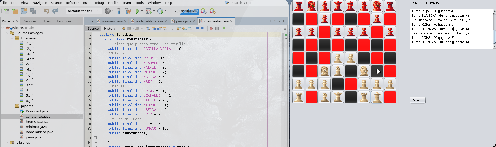

# JAjedrez - Ajedrez con Inteligencia Artificial

**Inteligencia Artificial (INF-418)**

Permite a un jugador humano (piezas blancas) enfrentarse a la computadora (piezas rojas), la cual utiliza el algoritmo **Minimax con poda Alfa-Beta** para decidir sus movimientos.

### Proyecto compilado 


---

## Inteligencia Artificial

### Algoritmo Minimax con Poda Alfa-Beta
 `minimax.java` y evalua el arbol de juego hasta una **profundidad fija de 3 movimientos**.

- **`valorMax()`**: turno del humano (maximizador)
- **`valorMin()`**: turno del PC (minimizador)
- La poda Alfa-Beta descarta ramas no prometedoras para mejorar el rendimiento

### Funcion Heuristica
La evaluacion de cada posicion del tablero considera:

| Pieza   | Valor base | Bonificaciones                        |
|---------|-----------|----------------------------------------|
| Peon    | 100       | +12 por centro, +2 por fila avanzada  |
| Caballo | 315       | ±15 / ±5 según cercanía al centro     |
| Alfil   | 330       | ±15 centro + bonificación por movilidad |
| Torre   | 500       | Bonificación por movilidad             |
| Reina   | 940       | ±10 centro + bonificación por movilidad |
| Rey     | 20000     | (protegido)                           |

La evaluación final es: `utilidad = puntos_negras - puntos_blancas` (el PC minimiza, el humano maximiza).

### Generacion de Movimientos
`nodoTablero.java` genera todos los movimientos legales para cada pieza del turno actual, creando nodos hijos que representan los posibles estados del tablero.

---

## Funcionalidades del Juego

- **Tablero 8×8** con todas las piezas clasicas
- **Validacion completa** de movimientos para cada tipo de pieza (pe0on, caballo, alfil, torre, reina, rey)
- **Enroque** (corto y largo para blancas)
- **Deteccion de jaque**
- **Deteccion de jaque mate** (implementada)
- **Captura de piezas** con visualizacion de piezas comidas
- **Bitácora de movimientos** en tiempo real
- **Reinicio de partida** con un clic

---

##  Estructura del Proyecto

```
JAjedrez/
├── src/jajedres/
│   ├── Principal1.java     # GUI principal y logica del juego
│   ├── constantes.java     # Constantes (tipos de piezas, turnos)
│   ├── pieza.java          # JButton que representa una casilla del tablero
│   ├── heuristica.java     # Validacion de movimientos + evaluacion heuristica
│   ├── nodoTablero.java    # Nodo del arbol de juego (genera hijos)
│   └── minimax.java        # Algoritmo Minimax con poda Alfa-Beta
├── src/Imagenes/           # Sprites GIF de las piezas (50×50)
├── nbproject/              # Configuración del proyecto NetBeans
└── build.xml               # Script de compilación Ant
```

### Requisitos
- Java JDK 13 o superior

## Compilacion y Ejecución

Abrir el proyecto en NetBeans y ejecutar 
